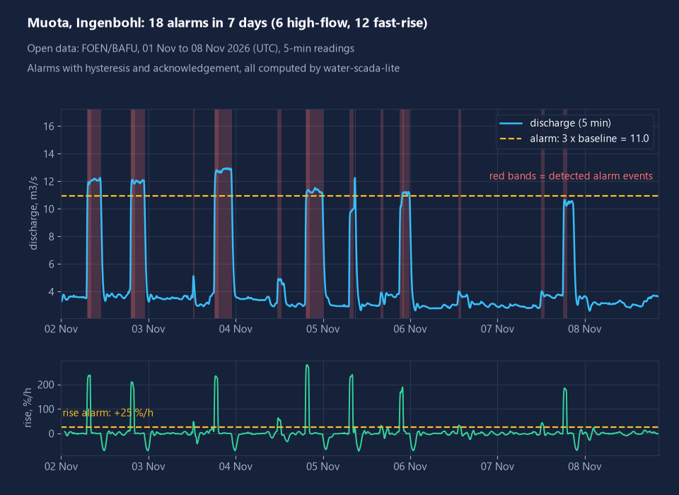
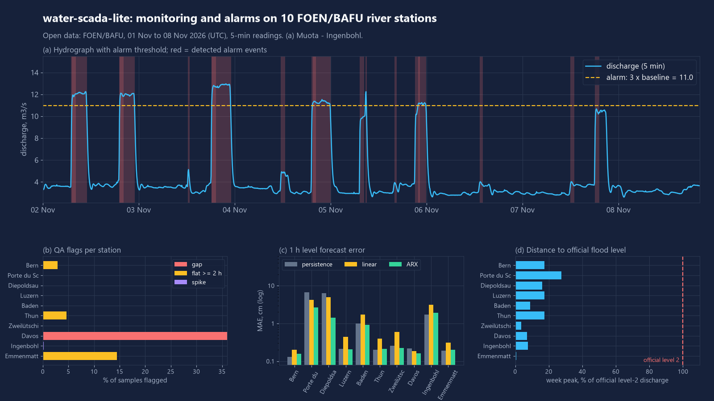
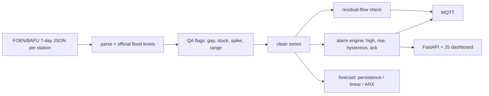

# water-scada-lite

Lightweight monitoring and alarm system for water utilities and small hydropower, run here on real Swiss river-gauge data: data-quality flags, threshold and rate-of-rise alarms with hysteresis and acknowledgement, residual-flow compliance, a short-horizon level forecast, MQTT output and a small web dashboard.





## What it does

- **Ingest** 10 FOEN/BAFU hydrological stations (water level, discharge, 5-min readings in the cached snapshot) and the official flood-danger discharge levels (levels 2-5) published with each station.
- **QA flags** per sample: gap (missing/stale), stuck (flat for >= 2 h), spike (isolated Hampel outlier; steep real flanks are not flagged), range. Flagged samples are excluded from alarms and the forecast.
- **Alarms** on discharge: official danger-level thresholds, a baseline-relative "elevated flow" threshold (3 x median of the first 48 h), and rate-of-rise (%/h over 60 min). Debounce, hysteresis, and an acknowledgement state machine (`active_unack -> active_ack -> cleared`, or `cleared_unack -> cleared`).
- **Flood-level comparison**: peak discharge vs the official danger levels of each station.
- **Residual-flow check** for a hypothetical small-hydro intake: configurable minimum flow and intake capacity, allowed diversion `clip(Q - Qmin, 0, capacity)`, violation episodes.
- **Forecast** of the water level 1 h and 3 h ahead: persistence vs linear extrapolation vs a ridge ARX model (lagged level differences plus discharge changes), chronological train/test split, MAE in cm.
- **Outputs**: retained MQTT JSON topics (`waterscada/<station>/state|residual_flow|alarm/<id>`), JSON results, FastAPI JSON API and a plain-JS dashboard with an Ack button.

Modbus and OPC UA are not implemented; they are the generic field interfaces such a system would normally also speak, and are listed under "not verified yet".

## Results

Measured on the cached snapshot: 10 stations, 2026-11-01 23:00 UTC to 2026-11-08 19:20 UTC (fetched 2026-11-08 19:51 UTC), 19,730 expected discharge samples. Source: FOEN/BAFU.

| Measure | Result |
|---|---|
| Completeness (discharge) | 9 stations 100.0 %, Davos Dischmabach 63.96 % (feed stale for 260 min at fetch time) |
| Stuck-sensor candidates (flat >= 2 h) | Emmenmatt 14.5 %, Thun 4.6 %, Bern 2.9 %, others 0 % |
| Spikes flagged | Muota 4, Baden 2, others 0 |
| Alarms, whole week | 36: Muota 18 (12 rise, 6 elevated), Rhine Diepoldsau 10, Rhone Porte du Scex 5, Emme 2, Aare Thun 1, 4 stations 0 |
| Official flood level reached | none (highest: Rhone Porte du Scex at 27.6 % of its level-2 discharge) |
| 1 h level forecast, MAE persistence -> ARX | Rhone 6.64 -> 2.63 cm, Rhine 6.38 -> 1.42 cm; ARX better at 6 of 10 stations, worse at 4 (Bern, Thun, Muota, Emme) |
| 3 h level forecast, MAE persistence -> ARX | Rhone 17.5 -> 13.5 cm, Rhine 15.5 -> 8.6 cm; ARX better at 6 of 10 |
| Residual flow, hypothetical intakes (min 0.4-2.5 m3/s, capacity 0.1-1.0 m3/s) | an intake that always diverts its full capacity would breach the minimum flow 5.1 % (Emme) to 78.3 % (Weisse Lutschine) of the time |

Reading these honestly:

- The week was calm. No official flood level was approached, so the flood comparison is a distance, not a detection. The 36 alarms come from the generic rise-rate and elevated-flow rules. Muota and the Rhine show repeated daily flow pulses that look like hydropower operation (hydropeaking); that is an interpretation of the shape, not something the data states.
- ARX only wins where the level moves. At calm stations the persistence error is 0.1-0.3 cm, which is around the sensor resolution, and ARX is no better.
- The residual-flow minima and intake capacities are assumptions chosen inside each river's observed range, to show the logic. They are not real concessions.

## Quick start

```bash
python -m venv .venv && . .venv/bin/activate        # Windows: .venv\Scripts\activate
pip install -e ".[dev]"
python -m water_scada_lite demo                      # offline, from the cached snapshot; prints the table above
python -m water_scada_lite demo --figures            # also rewrites docs/figure.png and docs/post-figure.png
python -m water_scada_lite demo --live               # fetch current data (the alarm counts will differ)
python -m water_scada_lite serve                     # dashboard at http://127.0.0.1:8000
python -m water_scada_lite mqtt --host localhost     # retained topics to a broker
python -m water_scada_lite fetch                     # refresh fixtures/ from the portal
python -m pytest -q && ruff check .
```

The demo acknowledges every second alarm as a simulated operator so both acknowledged and open states appear; results and MQTT messages are written to `out/`.

Station list, thresholds, intake assumptions and forecast settings are in `water_scada_lite/config/stations.toml`.

## How it works



## Data sources

- Hydrological station data (water level, discharge, official flood-danger discharge levels): FOEN/BAFU (Swiss Federal Office for the Environment), https://www.hydrodaten.admin.ch. Source: FOEN/BAFU. Use is subject to the FOEN terms for hydrological data.
- Endpoint used: the per-station chart document `https://www.hydrodaten.admin.ch/plots/p_q_7days/<station>_p_q_7days_de.json` (the data behind the portal's 7-day level/discharge chart). This is a portal endpoint, not a documented, versioned API, so it can change; the parser is tested against the cached snapshot in `fixtures/`. The same office also publishes hydrological data as linked data on the LINDAS SPARQL endpoint (`https://lindas.admin.ch/query`, graph `https://lindas.admin.ch/foen/hydro`); that endpoint answered a small query when checked, but it is not used by this repo.
- Only the last 7 days are available from this endpoint, so every measured period here is one week.

## What is not verified yet

- Only one week of one calm period. No flood, no sensor fault beyond one stale feed was seen, so detection of real floods and real stuck sensors is untested; the official-level alarms are exercised only by unit tests.
- Stuck-sensor flags on low-flow stations (Emme, Thun, Bern) may be real flat flow at the sensor resolution rather than faults; the flag cannot tell the two apart.
- Alarm thresholds (25 %/h rise, 3 x baseline) are generic defaults, not tuned or validated against operator experience, and the baseline uses the first 48 h of the same snapshot.
- Residual-flow minima and capacities are hypothetical. The check treats the gauge flow as the flow arriving at the intake; a real scheme needs the licensed minimum flow and a gauge placed correctly relative to the intake.
- Forecast: one 60/40 chronological split on one week; MAE differences on calm stations are below sensor resolution. Not an official forecast and not a warning service.
- The data is 5-min in this snapshot; other stations or periods may publish 10-min data and are handled by inferring the step, but only the snapshot was tested.
- MQTT publishing was tested with a fake client and a dry-run file, not against a live broker. The dashboard JavaScript was served and its API tested, but not browser-tested.
- Modbus and OPC UA interfaces are not implemented. Water temperature is not ingested (not in the endpoint used).

## Licence

MIT, Copyright (c) 2026 Victor Bonilla.
